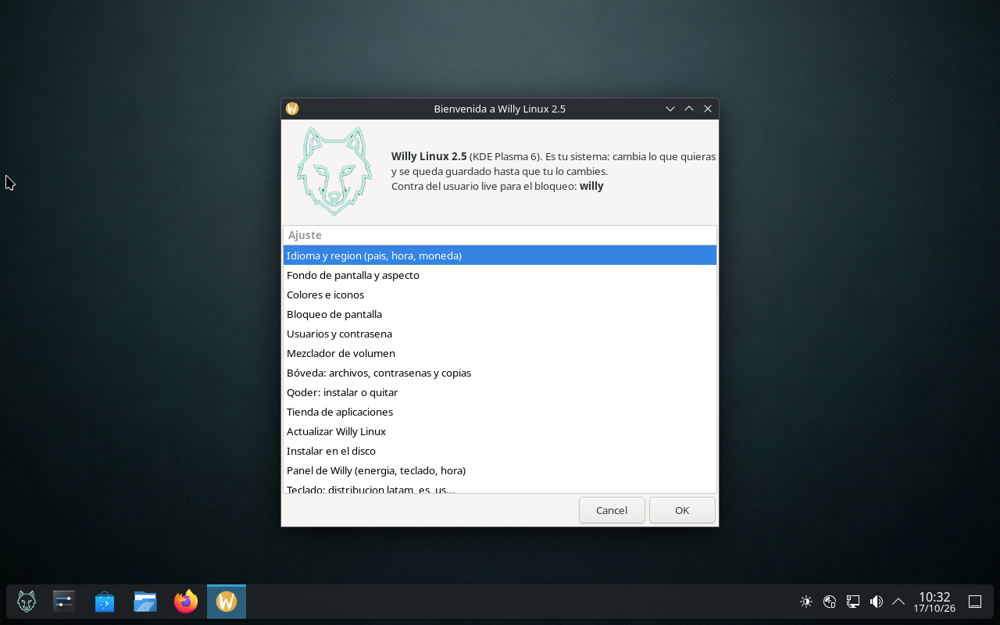

<p align="center">
  
</p>

# Willy Linux

**Willy Linux es una distribución Linux live, en español, pensada para resucitar ordenadores
poco potentes y para funcionar igual de bien instalada en el disco.** Nace de Debian
estable (trixie, Debian 13) con la herramienta oficial `live-build`, y añade un instalador
propio, un asistente de configuración en español y un conjunto de arreglos para que el audio,
el vídeo, la tienda de aplicaciones y el teclado latinoamericano funcionen sin tocar nada.

No es un sistema para presumir de especificaciones: es un sistema para encender un equipo con
3, 4 o 6 GB de RAM y ponerse a trabajar. Todas sus ediciones arrancan **en BIOS y en UEFI**,
desde **USB grabado** (Rufus en modo DD o `dd`) y en **máquina virtual**.

> **Software libre y abierto.** Todo el contenido de este repositorio —scripts, configuración,
> documentación e imágenes de marca— es de código abierto. No se incluyen nombres, firmas ni
> créditos personales. Consulta [licencia y créditos](docs/licencia.md).


---

## Ediciones

| Edición | Escenario | Tope de ISO | RAM objetivo | Estado |
|---|---|---|---|---|
| **1.0** | primera prueba arrancable | 2 GB | equipos muy viejos | histórica |
| **1.1** | ligera con más programas | 3 GB | 2–3 GB | entregada 2026-10-12 |
| **2.0 Minimalista** | la más ligera, IceWM | 4 GB | 3–4 GB | congelada a propósito (ver nota) |
| **2.1 Minimalista** | 2.0 + instalador, USB persistente, impresión, Bluetooth y actualizar | 4 GB | 3–4 GB | entregada 2026-10-12 |
| **2.5** | escritorio completo KDE Plasma 6 | 8 GB | 6–7 GB | entregada 2026-10-17 |
| **2.5.5** | misma imagen que 2.5 con su etiqueta de versión | 8 GB | 6–7 GB | entregada 2026-10-17 |

Comparativa completa, con tamaño real, número de paquetes y SHA-256 de cada ISO:
[tabla de ediciones](docs/ediciones.md) e [historial con todos los cambios](docs/historial.md).

**Nota sobre la 2.0:** quedó congelada con dos defectos visuales (iconos de catálogo que no
existen en el menú y el editor de texto por defecto). Se corrigieron en la 2.1 y el usuario
mandó no recompilar la 2.0. Sirve como referencia de comparación, no como descarga recomendada.

**Nota importante sobre instalar a disco:** **ninguna ISO compilada antes del 2026-10-14 puede
instalarse a disco**: les faltaban los binarios `grub-install` y `grub-bios-setup`, así que
copiaban el sistema pero no dejaban el disco arrancable. Desde la 2.5 del 14-10 el instalador
comprueba esas herramientas **antes de borrar nada** y aborta si faltan.

---

## Qué la diferencia de otra distribución live

1. **Entra por el idioma y por el teclado.** Idioma `es_ES.UTF-8`, teclado **latinoamericano**
   y zona horaria `America/Bogota` ya en la línea de arranque. No hay que configurar nada para
   escribir con `Ñ` y con `/` en el sitio de siempre.
2. **Un asistente propio, en español, de una sola pantalla.** Dieciséis opciones numeradas para
   cambiar idioma, fondo, colores, bloqueo, usuario y contraseña, volumen, bóveda, tienda,
   actualizaciones, instalación en disco, teclado, barra de tareas y guardado en el USB.
3. **El objetivo es el disco, no el USB.** `willy-instalar` particiona (GPT+ESP en UEFI, msdos
   en BIOS), crea swap si el equipo tiene poca RAM, copia el sistema, purga los paquetes live,
   regenera el initramfs y deja GRUB instalado y registrado en el firmware. Detecta Windows y
   lo añade al menú, y **nunca formatea la partición EFI de Windows**.
4. **Persistencia decidida por el usuario.** En el USB live se puede elegir que nada se guarde,
   que se guarde solo `/home`, o que se guarde todo. Se hace desde el asistente
   (*Guardar mis cambios*) y sobrevive a apagar el equipo.
5. **Sistema bóveda integrado.** Carpetas acorazadas de Plasma (cifrado con contraseña, se
   montan desde el propio gestor de archivos), **KeePassXC** para contraseñas y **Back In Time**
   con Borg para copias de seguridad.
6. **Tienda que sí lista Flathub.** Discover con PackageKit y Flatpak, con el remoto de Flathub
   corregido (`Url=`, no `URL=`, que es lo que hacía que no apareciera) y
   `update-desktop-database` para que las aplicaciones instaladas refresquen el menú.
7. **Audio y vídeo que funcionan de fábrica.** PipeWire + WirePlumber, los perfiles ALSA
   `ucm2`/`tplg` que muchos portátiles necesitan para que el volumen suba de verdad,
   `libcanberra-pulse` para el pitido del panel, y los controladores **VA-API** para que el
   vídeo se decodifique en la GPU y no en el procesador.
8. **Diagnóstico incluido.** `willy-red` responde con números si un vídeo trabado es culpa de
   internet o del navegador, y `willy-monitor`, `willy-info` y `willy-trafico` dan el estado del
   equipo sin abrir un terminal.
9. **Todo se comprueba contra la ISO, no contra el log.** Cada entrega se verifica montando la
   imagen y mirando dentro del `filesystem.squashfs`, y se publica su SHA-256.
   [Cómo verificar una ISO](docs/verificar-la-iso.md).

---

## Capturas

| | |
|---|---|
| Arranque (Plymouth + Plasma) | Mezclador de volumen (pavucontrol sobre PipeWire) |
|  |  |
| Instalador: elección de disco en UEFI | Asistente completo, 16 opciones |
|  |  |

Fondos de pantalla e icono incluidos en la imagen:
[logo](img/logo-512.png) · [fondo lobito](img/fondo-lobito.png) ·
[fondo agua](img/fondo-agua.png) · [pantalla de arranque](img/fondo-arranque.png)

---

## Descargas

Las ISO pesan entre 671 MB y 1763 MB, **demasiado para un repositorio de Git** (GitHub rechaza
ficheros de más de 100 MB en el árbol y limita los repos). Por eso:

- **Este repositorio contiene la receta completa** (config, hooks, listas de paquetes,
  instalador, utilidades y documentación). Con ella se reconstruye cualquier edición, byte a
  byte, con `live-build`.
- **Las ISO publicadas van en la pestaña *Releases* de este repositorio**, una etiqueta por
  versión, con su `.iso`, su `.sha256` y las notas del [historial](docs/historial.md).
- Verifica siempre el hash antes de grabar: [cómo verificar la ISO](docs/verificar-la-iso.md).

---

## Cómo se usa (resumen)

1. **Descarga** la ISO de tu edición y **verifica** su SHA-256.
2. **Graba** el USB: Rufus en modo **DD** (no ISO), o `dd if=... of=/dev/sdX bs=4M status=progress`.
3. **Arranca** eligiendo el USB en el menú de firmware (F12/F8/Esc según el equipo). En BIOS
   aparece el menú azul de isolinux; en UEFI, el menú de GRUB. Ambos en español y con 5 segundos
   de espera.
4. **Usuario live:** nombre `live`, contraseña `willy` (la pide el bloqueador de pantalla y
   `sudo` en el USB solo dentro de la sesión live).
5. Desde el asistente de bienvenida: **Instalar en el disco** para dejarlo como sistema
   operativo del equipo, o **Guardar mis cambios** para usarlo siempre desde el USB.

Guía paso a paso, con pantallas de firmware, dual boot y desinstalación:
[arranque e instalación](docs/arranque-e-instalacion.md).

---

## Qué lleva dentro

| Bloque | Contenido |
|---|---|
| Base | Debian 13 *trixie*, `amd64`, áreas `main` + `non-free-firmware`, `live-build` en modo `debian` |
| Escritorio (2.5) | KDE Plasma 6 con Wayland y sesión alternativa X11, Dolphin, Konsole, Discover, KWrite/Okular |
| Escritorio (1.x/2.x) | IceWM ligero con menú propio, LXTerminal, PCManFM, Firefox ESR, LibreOffice |
| Audio | PipeWire, WirePlumber, `pavucontrol-qt`, `alsa-utils`, `alsa-ucm-conf`, `alsa-topology-conf`, `libcanberra-pulse` |
| Vídeo y códecs | GStreamer good/bad/ugly/libav, FFmpeg, VLC, mpv, Audacity, `gstreamer1.0-vaapi`, controladores VA-API (i965, intel-media, Mesa VA-VDPAU), `vainfo` |
| Tienda | Discover + PackageKit + Flatpak con Flathub, `desktop-file-utils` |
| Bóveda | Plasma Vault (cryfs), KeePassXC, Back In Time, Borg |
| Red | NetworkManager, `willy-red`, `willy-trafico` |
| Impresión y Bluetooth (2.1/2.5) | CUPS con su configurador, BlueZ con Bluedevil |
| Instalador | `grub2-common`, `grub-pc`, `grub-efi-amd64-bin`, `efibootmgr`, `os-prober`, parted, rsync |
| Rendimiento | `zram-tools`, `earlyoom`, microcódigo de CPU, aceleración por software (`llvmpipe`) para máquina virtual |
| Firmware | `firmware-linux-free`/`-nonfree` y controladores de WiFi, Bluetooth, sonido y gráfica habituales |

Listado completo por archivo de paquetes: [especificaciones técnicas](docs/especificaciones.md).

## Herramientas propias

| Comando | Qué hace |
|---|---|
| `willy-bienvenida` | Asistente de 16 opciones (idioma, teclado, fondo, bóveda, instalar, guardar cambios…) |
| `willy-ajustes` | Panel de control propio, 16 apartados, con atajo en la barra |
| `willy-instalar` | Instalador al disco con selección de disco, confirmación escrita y prefight de GRUB |
| `willy-persistencia` | Crea/aumenta la partición `persistence` del USB y elige qué se guarda |
| `willy-actualizar` | Actualiza el sistema y muestra qué cambió |
| `willy-guardado` | Dice si el sistema está en modo volátil, persistente o instalado |
| `willy-renombre-aplicar` / `willy-identidad` | Cambiar el nombre del equipo y del usuario sin romper nada |
| `willy-medio` | Localiza dónde montó live-boot el USB (los nombres cambiaron entre versiones) |
| `willy-red` | Diagnóstico de red: pérdida, retardo, DNS, velocidad HTTPS real y veredicto |
| `willy-info`, `willy-monitor`, `willy-trafico` | Ficha del equipo, consumo en vivo y tráfico por interfaz |
| `willy-captura` | Captura de pantalla con retardo, sin instalar nada más |
| `willy-sudo` | Eleva con la contraseña en el entorno, nunca escrita en un archivo |

Detalle y salidas de cada una: [uso diario](docs/uso-diario.md).

---

## Limitaciones conocidas (y por qué)

- **Netflix, Disney+, Prime Video y Max no reproducen vídeo.** El `firefox-esr` de Debian no
  incluye Widevine; no es un fallo de la ISO ni del enlace. Solución: Chromium desde Discover.
- **Secure Boot en el disco instalado.** La ISO no lleva `shim-signed`, así que un disco
  instalado con Secure Boot activado no arranca. El instalador lo detecta y avisa: desactiva
  Secure Boot o deja el modo *Other OS*. Añadir shim son ~40 MB y un enrolado MOK nuevo; se
  decidió no incluirlo.
- **VLC se ve gris en la 2.5.** En la imagen solo hay estilos de Qt6; `kde-style-breeze-qt5`
  son 629 KB más librerías KF5 y se descartó a propósito por ser solo cosmético.
- **Solo 64 bits (`amd64`).** Para equipos de 32 bits hay que arrancar otra distribución.
- **Vídeo 1080p60 en máquina virtual con 2 CPU** se decodifica por software y se atraganta: es
  esperado, no un defecto. En hardware real con GPU, los controladores VA-API ya están dentro.
- **El volumen puede aparecer mudo en tarjetas muy raras** sin perfil `ucm2`; el asistente deja
  abrir el mezclador y `alsa-utils` está incluido para desilenciar a mano.

Lista ampliada con síntomas y soluciones: [solución de problemas](docs/solucion-de-problemas.md).

---

## Integridad de las ISOs

Cada entrega se publica con su SHA-256 y se conserva la anterior con `.bak-día.hora` y su hash:
**ninguna ISO se borra**. La tabla con todos los ficheros, tamaños y hashes está en
[historial](docs/historial.md).

```sh
# Linux / WSL
sha256sum willylinux-v2.5-kde-amd64.iso
# Windows (PowerShell)
Get-FileHash -Algorithm SHA256 .\willylinux-v2.5-kde-amd64.iso
```

---

## Contenido de este repositorio

```
README.md                 esta presentación
docs/
  ediciones.md            comparativa de las 6 ediciones
  historial.md            cambios y mejoras de cada ISO, con hashes
  arranque-e-instalacion.md  USB, BIOS/UEFI, instalador, persistencia, dual boot
  uso-diario.md           asistente, panel de ajustes, herramientas willy-*
  especificaciones.md     base técnica, listas de paquetes, parámetros de arranque
  solucion-de-problemas.md  síntomas, causas y arreglos
  verificar-la-iso.md     cómo comprobar una ISO sin fiarse del log
  compilar.md             cómo se construye la imagen (live-build en WSL2)
  licencia.md             código abierto, licencias y marcas
img/                      logo, fondos y capturas reales
src/tree-2.5/             configuración completa de la edición 2.5 / 2.5.5
src/tree-2.0/             configuración completa de las ediciones ligeras
```

Los árboles `src/` son la fuente real de la imagen: `auto/config` (opciones de `lb config`),
`package-lists/*.list.chroot` (cada paquete, porque la compilación usa
`--apt-recommends false`) y `hooks/live/*.hook.chroot` (las herramientas, el instalador, el
asistente, Plasma y la identidad).
