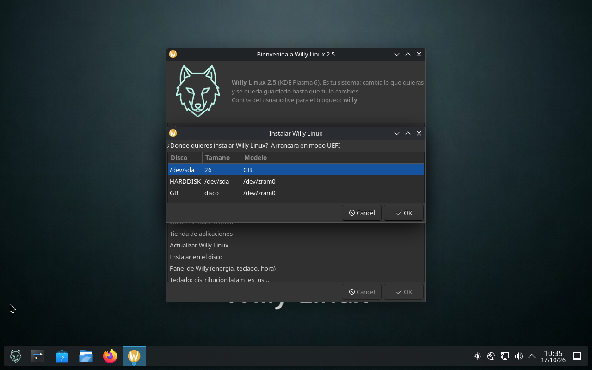

# Arranque e instalación

## 1. Requisitos

| | 1.1 | 2.0 / 2.1 | 2.5 / 2.5.5 |
|---|---|---|---|
| Arquitectura | 64 bits (`amd64`) | 64 bits | 64 bits |
| RAM mínima para probar | 2 GB | 3 GB | 4 GB |
| RAM recomendada | 3 GB | 4 GB | 6–7 GB |
| USB para live | 2 GB | 4 GB | 8 GB |
| USB con persistencia | 8 GB | 16 GB | 32 GB |
| Disco para instalar | — | 20 GB | 25 GB (recomendado 40 GB) |
| EFI o BIOS | ambos | ambos | ambos |

La 2.5 crea swap automáticamente si el equipo tiene menos de 8192 MB de RAM y un disco de al
menos 20 GB, así que en un portátil de 6 GB queda memoria de reserva sin que tengas que hacer
nada.

## 2. Bajar y verificar la ISO

```sh
sha256sum willylinux-v2.5-kde-amd64.iso          # Linux / WSL
```

```powershell
Get-FileHash -Algorithm SHA256 .\willylinux-v2.5-kde-amd64.iso   # Windows
```

Compara con la tabla de [historial](historial.md). Si no coincide, **no la grabes**: vuelve a
bajarla.

## 3. Grabar el USB

### Windows — Rufus

1. Rufus → dispositivo: el USB (se pierde todo lo que hubiera).
2. Imagen de arranque: la ISO de Willy Linux.
3. **Modo de particionado: DD** (Rufus preguntará; elige «Modo imagen DD»). El modo ISOHybrid
   por defecto también vale, pero DD es el que está probado en todos los equipos.
4. Empieza y espera a «LISTO».

### Linux / macOS — `dd`

```sh
sudo umount /dev/sdX*                 # sin la * final si no está montado
sudo dd if=willylinux-v2.5-kde-amd64.iso of=/dev/sdX bs=4M status=progress oflag=sync
sync
```

Escribe en `/dev/sdX` (el disco), **no** en `/dev/sdX1` (una partición).

### Lo que no sirve

- Copiar la ISO con el explorador de archivos: no deja el disco arrancable.
- Grabar en una partición NTFS o exFAT con un gestor de arranque de terceros.

## 4. El menú de arranque

Ambos menús están en español y esperan 5 segundos antes de arrancar la opción por defecto.

**BIOS (isolinux):** título `WILLY LINUX <versión>`, fondo con el logo, y estas entradas:

| Entrada | Para qué |
|---|---|
| `Willy Linux <versión> (por defecto)` | sesión live normal |
| `modo seguro` | sin aceleración ni códecs problemáticos, para equipos raros |
| `^Utilidades` → `Deteccion de hardware (HDT)` | informe de hardware por pantalla |
| `Comprobar la integridad del USB` | verifica la ISO contra el propio medio |

Teclas: `ENTER` arranca, `TAB` edita la línea, `F1` ayuda.

**UEFI (GRUB):** mismas opciones, más `Opciones avanzadas de arranque`,
`Ajustes del firmware UEFI` y `Comprobar la integridad del USB`.
Teclas: flechas para elegir, `Enter` arrancar, `e` editar, `c` consola.

Si tu equipo muestra los dos, usa **UEFI** (arranca más rápido y el instalador registra GRUB en
el firmware).

### Parámetros que ya vienen puestos

```
boot=live components quiet persistence username=live hostname=willylinux
locales=es_ES.UTF-8 keyboard-layouts=latam timezone=America/Bogota
```

- `persistence` hace que el USB **acepte** guardar cambios; si no existe partición
  `persistence`, arranca normal y no guarda nada.
- Para cambiar algo en un arranque concreto: `TAB` (BIOS) o `e` (UEFI) sobre la entrada y edita
  `keyboard-layouts=us`, `timezone=Europe/Madrid`, quita `quiet` para ver los mensajes de
  arranque, o añade `failsafe` / `nomodeset`.

## 5. La sesión live

| Dato | Valor |
|---|---|
| Usuario | `live` |
| Contraseña | `willy` (la piden el bloqueador de pantalla y `sudo`) |
| `sudo` en el live | sin contraseña, **solo** mientras se arranca desde USB |
| Nombre del equipo | `willylinux` |
| Idioma / teclado / hora | español, latam, `America/Bogota` |

En la 2.5 el asistente de bienvenida se abre solo al entrar. Si se cierra, vuelve con
`willy-bienvenida` o con el icono del lobito de la barra.

> Al instalar en el disco, **el sudo sin contraseña se quita** y la contraseña `willy` no se
> escribe en el disco: el instalador exige una contraseña propia.

## 6. Instalar en el disco

Desde el asistente: **11 · Instalar en el disco**. También en un terminal con `willy-instalar` o
escribiendo `instalar`.



*Captura del ensayo del 2026-10-17: muestra todavía la fila del disco entero y `zram0`, que son
los dos defectos que se corrigieron en la entrega de ese día.*

Qué hace, en orden:

1. **Preflight** antes de tocar nada: comprueba que `grub-install` (y `grub-bios-setup` si el
   equipo es BIOS) existen, que hay `efibootmgr` en UEFI y que el medio es realmente un USB live
   (helper `willy-medio`). Si falta algo, **aborta sin borrar nada**.
2. Elige el disco de destino en una lista (tamaño y modelo).
3. Pide que escribas **`BORRAR`** para confirmar. Sin esas seis letras no continúa.
4. Avisa si detecta NTFS o BitLocker en otro disco, y si **Secure Boot está activado** (el GRUB
   de la ISO no está firmado: desactívalo o pon «Other OS» antes de instalar).
5. Esquema: **GPT + partición EFI** en UEFI, **msdos** en BIOS; raíz ext4 y swap si la RAM es
   menor de 8 GB. También hay una rama manual con `cfdisk` para el que quiera decidir.
6. Formatea, `rsync --one-file-system` del sistema live al disco, `fstab` **por UUID**.
7. Purga `live-boot`, `live-config` y `user-setup`, **después** regenera el initramfs
   (`update-initramfs -u -k all`) para que no quede rastro del arranque live.
8. Crea el usuario con la contraseña que pediste (`chroot chpasswd`), lo añade a `sudo`,
   ejecuta `dpkg --configure -a`, quita el autologin de SDDM y renueva `machine-id`.
9. `grub-install` + `grub-mkconfig` con `GRUB_DISABLE_OS_PROBER=false`, montando `efivarfs` para
   registrarse en el NVRAM. **Windows aparece en el menú si está en el mismo equipo.**
10. Al terminar, apaga, quita el USB y arranca del disco.

### Lo que el instalador no toca

- **Nunca formatea la partición EFI de Windows**: usa la ESP que ya existe (`$SUDO blkid` para
  identificarla) y solo escribe ahí el GRUB de Willy Linux.
- No toca las particiones NTFS del sistema que ya tenías.

### Dual boot y desinstalación

Al ser GRUB el gestor, entras a cualquiera de los dos desde el menú. Para quitar Willy Linux:
arranca desde el USB o desde Windows, borra la entrada con
`efibootmgr -b <número> -B` (UEFI) o repara el arranque de Windows (BIOS), y formatea sus
particiones. La ESP de Windows sigue intacta, así que el arranque de Windows no se rompe.

## 7. Guardar los cambios en el USB (persistencia)

Desde el asistente: **16 · Guardar mis cambios (USB persistente)**, o `willy-persistencia`.

Elige uno de los tres modos:

| Modo | Qué se guarda |
|---|---|
| Nada | comportamiento live puro, cada arranque limpio |
| Solo `/home` | documentos, descargas, ajustes de usuario, contraseñas de la bóveda |
| Todo (`/`) | además los programas que instales y los cambios del sistema |

Qué ocurre por dentro: se crea (o se aprovecha) una partición con etiqueta `persistence` en el
propio USB, con su `persistence.conf` (`/home` o `/`) dentro. Al apagar, los cambios quedan ahí;
al encender, el parámetro `persistence` de la línea de arranque los monta.

`willy-guardado` te dice en qué modo estás en este momento: `volatil`, `persistente` o
`instalado`.

**Recomendación:** «solo `/home`» en un USB de 16 GB o más. El modo «todo» escribe mucho y
desgasta los USB baratos.

## 8. Probar en máquina virtual

Vale VirtualBox, GNOME Boxes o similar, con estos ajustes:

- 4 GB de RAM para la 2.5 (ella sola pide más para moverse cómoda), 2 CPU si puedes.
- **EFI activado** para probar el arranque UEFI, o desactivado para probar BIOS.
- Controlador gráfico `vmsvga` en VirtualBox 7.x.
- Un disco VDI virgen de 20–30 GB si quieres ensayar el instalador sin riesgo.

En la VM el vídeo se decodifica por software (`llvmpipe`): un 1080p60 de YouTube se atraganta y
**es esperado**, no es un defecto de la ISO. El audio y la tienda sí se pueden probar ahí, y de
hecho así se verificaron.

> **Windows + Hyper-V/WSL2 y VirtualBox no conviven.** Si tienes WSL2 activo, VirtualBox se cae
> al arrancar la VM. Hay que apagar la plataforma de hipervisor y reiniciar para probar en
> VirtualBox, y volver a encenderla para compilar en WSL2.

## 9. Si el equipo no arranca desde el USB

1. Entra al firmware (suele ser `F12`, `F8`, `Esc`, `F2` o `Del` al encender) y elige el USB en
   el menú de arranque temporal.
2. Si no aparece: desactiva **Secure Boot** y prueba en modo **UEFI** o en **Legacy/CSM**.
3. Algunos portátiles ignoran USB 3.0 en el arranque: prueba un puerto USB 2.0.
4. Prueba `modo seguro` desde el menú (sin aceleración gráfica).
5. Revisa la grabación: `Comprobar la integridad del USB` desde el propio menú.

Más síntomas y soluciones: [solución de problemas](solucion-de-problemas.md).
