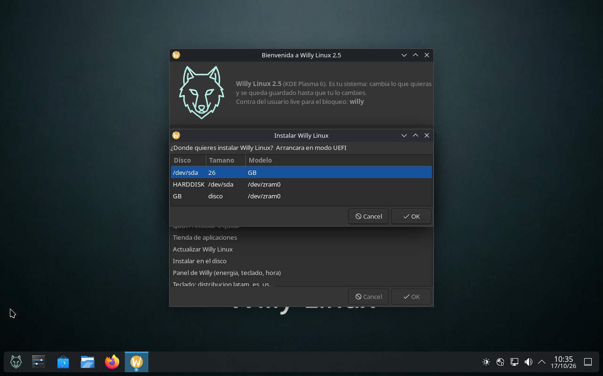

# Arranque e instalación

## 1. Requisitos

| | 1.1 | 2.0 / 2.1 | 2.5 / 2.5.5 | 2.8 |
|---|---|---|---|---|
| Arquitectura | 64 bits (`amd64`) | 64 bits | 64 bits | 64 bits |
| RAM mínima para probar | 2 GB | 3 GB | 4 GB | 4 GB |
| RAM recomendada | 3 GB | 4 GB | 6–7 GB | 6–7 GB |
| USB para live | 2 GB | 4 GB | 8 GB | 8 GB |
| USB con persistencia | 8 GB | 16 GB | 32 GB | 32 GB |
| Disco para instalar | — | 20 GB | 25 GB (recomendado 40 GB) | 25 GB (recomendado 40 GB) |
| EFI o BIOS | ambos | ambos | ambos | ambos, **instalados y arrancados en VM el 2026-11-07** |

La 2.5 crea swap automáticamente si el equipo tiene menos de 8192 MB de RAM y un disco de al
menos 20 GB, así que en un portátil de 6 GB queda memoria de reserva sin que tengas que hacer
nada.

## 2. Bajar y verificar la ISO

```sh
sha256sum willylinux-v2.5-kde-amd64.iso          # Linux / WSL
```

```powershell
Get-FileHash -Algorithm SHA256 .\willylinux-v2.5-kde-amd64.iso   # Windows
```

Compara con la tabla de [historial](historial.md). Si no coincide, **no la grabes**: vuelve a
bajarla.

## 3. Grabar el USB

### Windows — Rufus

1. Rufus → dispositivo: el USB (se pierde todo lo que hubiera).
2. Imagen de arranque: la ISO de Willy Linux.
3. **Modo de particionado: DD** (Rufus preguntará; elige «Modo imagen DD»). El modo ISOHybrid
   por defecto también vale, pero DD es el que está probado en todos los equipos.
4. Empieza y espera a «LISTO».

### Linux / macOS — `dd`

```sh
sudo umount /dev/sdX*                 # sin la * final si no está montado
sudo dd if=willylinux-v2.5-kde-amd64.iso of=/dev/sdX bs=4M status=progress oflag=sync
sync
```

Escribe en `/dev/sdX` (el disco), **no** en `/dev/sdX1` (una partición).

### Lo que no sirve

- Copiar la ISO con el explorador de archivos: no deja el disco arrancable.
- Grabar en una partición NTFS o exFAT con un gestor de arranque de terceros.

## 4. El menú de arranque

Ambos menús están en español y esperan 5 segundos antes de arrancar la opción por defecto.

**BIOS (isolinux):** título `WILLY LINUX <versión>`, fondo con el logo, y estas entradas:

| Entrada | Para qué |
|---|---|
| `Willy Linux <versión> (por defecto)` | sesión live normal |
| `modo seguro` | sin aceleración ni códecs problemáticos, para equipos raros |
| `^Utilidades` → `Deteccion de hardware (HDT)` | informe de hardware por pantalla |
| `Comprobar la integridad del USB` | verifica la ISO contra el propio medio |

Teclas: `ENTER` arranca, `TAB` edita la línea, `F1` ayuda.

**UEFI (GRUB):** mismas opciones, más `Opciones avanzadas de arranque`,
`Ajustes del firmware UEFI` y `Comprobar la integridad del USB`.
Teclas: flechas para elegir, `Enter` arrancar, `e` editar, `c` consola.

Si tu equipo muestra los dos, usa **UEFI** (arranca más rápido y el instalador registra GRUB en
el firmware).

### Parámetros que ya vienen puestos

```
boot=live components quiet persistence username=live hostname=willylinux
locales=es_ES.UTF-8 keyboard-layouts=latam timezone=America/Bogota
```

- `persistence` hace que el USB **acepte** guardar cambios; si no existe partición
  `persistence`, arranca normal y no guarda nada.
- Para cambiar algo en un arranque concreto: `TAB` (BIOS) o `e` (UEFI) sobre la entrada y edita
  `keyboard-layouts=us`, `timezone=Europe/Madrid`, quita `quiet` para ver los mensajes de
  arranque, o añade `failsafe` / `nomodeset`.

### Secure Boot

La ISO **no lleva `shim-signed`** y su arrancador no está firmado por Microsoft. Comprobado dentro
del artefacto con `src/pruebas/comprobar-seguro-arranque.py`: en `EFI.IMG` está
`/EFI/BOOT/BOOTX64.EFI` (585.728 B) **sin tabla de certificados Authenticode**, y en la lista de
paquetes figuran `grub-efi-amd64-bin` y `efibootmgr` pero no `shim-signed` ni `mokutil`. El mismo
programa, aplicado a `bootmgfw.efi` de Windows, sí encuentra la firma.

Qué significa al usarla:

| caso | con Secure Boot activado |
|---|---|
| USB arrancando en UEFI | lo esperado es que el firmware lo rechace (`Security Violation`) o que la entrada UEFI ni aparezca |
| disco instalado arrancando en UEFI | **no arranca**: `grubx64.efi` tampoco está firmado |
| cualquier caso en BIOS / Legacy | no aplica: Secure Boot no existe en BIOS |

Por eso, antes de instalar, **desactiva Secure Boot o deja «Other OS»** en el firmware (*Boot*,
*Security* o *Authentication*). El instalador lo detecta leyendo la variable EFI y avisa antes de
empezar. **Si el equipo tiene Windows con BitLocker**, suspende la protección antes: cambiar
Secure Boot mueve la medida PCR7 y Windows puede pedir la clave de recuperación.

Las alternativas a apagarlo —enrolar el hash del arrancador en el firmware, o instalar
`shim-signed` y `mokutil` en el disco y enrolar la clave MOK— están explicadas en
[solución de problemas](solucion-de-problemas.md#secure-boot-qué-rechaza-de-esta-iso-y-las-tres-salidas).

## 5. La sesión live

| Dato | Valor |
|---|---|
| Usuario | `live` |
| Contraseña | `willy` (la piden el bloqueador de pantalla y `sudo`) |
| `sudo` en el live | sin contraseña, **solo** mientras se arranca desde USB |
| Nombre del equipo | `willylinux` |
| Idioma / teclado / hora | español, latam, `America/Bogota` |

> **En qué ISO eso es cierto.** La contraseña `willy` se escribe en la propia imagen desde la
> receta corregida el 2026-11-07. Las ISO quemadas antes de esa fecha —la 2.8 del 2026-10-20
> entre ellas— llevaban la cuenta live **sin hash** en `/etc/shadow`, y al bloquearse la pantalla
> no había forma de volver dentro. Está en
> [solución de problemas](solucion-de-problemas.md#la-pantalla-de-bloqueo-pide-una-contraseña-que-no-me-sé).

En la 2.5 el asistente de bienvenida se abre solo al entrar. Si se cierra, vuelve con
`willy-bienvenida` o con el icono del lobito de la barra.

> Al instalar en el disco, **el sudo sin contraseña se quita** y la contraseña `willy` no se
> escribe en el disco: el instalador exige una contraseña propia.

## 6. Instalar en el disco

Desde el asistente: **11 · Instalar en el disco**. También en un terminal con `willy-instalar` o
escribiendo `instalar`.



*Captura del ensayo del 2026-10-17: muestra todavía la fila del disco entero y `zram0`, que son
los dos defectos que se corrigieron en la entrega de ese día.*

Qué hace, en orden:

1. **Preflight** antes de tocar nada: comprueba que `grub-install` (y `grub-bios-setup` si el
   equipo es BIOS) existen, que hay `efibootmgr` en UEFI y que el medio es realmente un USB live
   (helper `willy-medio`). Si falta algo, **aborta sin borrar nada**.
2. Elige el disco de destino en una lista (tamaño y modelo).
3. Pide que escribas **`BORRAR`** para confirmar. Sin esas seis letras no continúa.
4. Avisa si detecta NTFS o BitLocker en otro disco, y si **Secure Boot está activado** (el GRUB
   de la ISO no está firmado: desactívalo o pon «Other OS» antes de instalar).
5. Esquema: **GPT + partición EFI** en UEFI, **msdos** en BIOS; raíz ext4 y swap si la RAM es
   menor de 8 GB. También hay una rama manual con `cfdisk` para el que quiera decidir. (En las ISO
   publicadas hasta el 2026-10-17 la rama BIOS fallaba al crear las particiones; está explicado en
   [solución de problemas](solucion-de-problemas.md#no-se-pudo-particionar-al-elegir-el-esquema-recomendado-en-un-equipo-bios).)
6. Formatea, `rsync --one-file-system` del sistema live al disco, `fstab` **por UUID**.
7. Purga `live-boot`, `live-config` y `user-setup`, **después** regenera el initramfs
   (`update-initramfs -u -k all`) para que no quede rastro del arranque live.
8. Crea el usuario con la contraseña que pediste (`chroot chpasswd`), lo añade a `sudo`,
   ejecuta `dpkg --configure -a`, quita el autologin de SDDM y renueva `machine-id`.

   > **Ojo con el autologin en ISO anteriores al arreglo del 2026-11-07.** SDDM lee
   > `/etc/sddm.conf` **y** `/etc/sddm.conf.d/*.conf` y mezcla los dos; dejar comentada la línea
   > `User=` en uno no anula la del otro. En el ensayo del 07-11 el disco instalado entraba al
   > escritorio sin pedir contraseña. Compruébalo con
   > `grep -rn -A2 '\[Autologin\]' /etc/sddm.conf /etc/sddm.conf.d/`.
9. `grub-install` + `grub-mkconfig` con `GRUB_DISABLE_OS_PROBER=false`, montando `efivarfs` para
   registrarse en el NVRAM. **Windows aparece en el menú si está en el mismo equipo.**
10. Al terminar, apaga, quita el USB y arranca del disco.

### Lo que el instalador no toca

- **Nunca formatea la partición EFI de Windows**: usa la ESP que ya existe (`$SUDO blkid` para
  identificarla) y solo escribe ahí el GRUB de Willy Linux.
- No toca las particiones NTFS del sistema que ya tenías.

### Dual boot y desinstalación

Al ser GRUB el gestor, entras a cualquiera de los dos desde el menú. Para quitar Willy Linux:
arranca desde el USB o desde Windows, borra la entrada con
`efibootmgr -b <número> -B` (UEFI) o repara el arranque de Windows (BIOS), y formatea sus
particiones. La ESP de Windows sigue intacta, así que el arranque de Windows no se rompe.

## 7. Guardar los cambios en el USB (persistencia)

Desde el asistente: **16 · Guardar mis cambios (USB persistente)**, o `willy-persistencia`.

Elige uno de los tres modos:

| Modo | Qué se guarda |
|---|---|
| Nada | comportamiento live puro, cada arranque limpio |
| Solo `/home` | documentos, descargas, ajustes de usuario, contraseñas de la bóveda |
| Todo (`/`) | además los programas que instales y los cambios del sistema |

Qué ocurre por dentro: se crea (o se aprovecha) una partición con etiqueta `persistence` en el
propio USB, con su `persistence.conf` (`/home` o `/`) dentro. Al apagar, los cambios quedan ahí;
al encender, el parámetro `persistence` de la línea de arranque los monta.

`willy-guardado` te dice en qué modo estás en este momento: `volatil`, `persistente` o
`instalado`.

**Recomendación:** «solo `/home`» en un USB de 16 GB o más. El modo «todo» escribe mucho y
desgasta los USB baratos.

## 8. Probar en máquina virtual

Vale VirtualBox, GNOME Boxes o similar, con estos ajustes:

- 4 GB de RAM para la 2.5 (ella sola pide más para moverse cómoda), 2 CPU si puedes.
- **EFI activado** para probar el arranque UEFI, o desactivado para probar BIOS.
- Controlador gráfico `vmsvga` en VirtualBox 7.x.
- Un disco VDI virgen de 20–30 GB si quieres ensayar el instalador sin riesgo.

En la VM el vídeo se decodifica por software (`llvmpipe`): un 1080p60 de YouTube se atraganta y
**es esperado**, no es un defecto de la ISO. El audio y la tienda sí se pueden probar ahí, y de
hecho así se verificaron.

### Qué se ensayó el 2026-11-07 con la ISO 2.8

Instalación real, de principio a fin, en VirtualBox, **en los dos modos de arranque**, cada uno en
su máquina virtual (`willy28-bios` y `willy28-uefi`, disco VDI de 20 GB vacío, sin USB
persistente):

| | UEFI | BIOS |
|---|---|---|
| Particionado del esquema recomendado | ✅ GPT + ESP | ✅ msdos, sin el `invalid token` que tenía la 2.5 |
| Confirmación escribiendo `BORRAR` | ✅ | ✅ |
| Copia del sistema | ✅ 5.073 MB | ✅ (VDI de destino creció a 5,7 GB) |
| Arranque **desde el disco**, con la ISO retirada | ✅ `willyroot: clean` y escritorio | ✅ escritorio a las 11:15, con la bienvenida |
| Panel centrado | ❌ sale a la izquierda | ❌ igual |
| Bloqueo de pantalla en la live | ❌ ni `willy` ni `live` abren (cuenta sin hash) | ❌ |
| Disco instalado entra sin pedir contraseña | ❌ SDDM conserva el autologin | ❌ |
| Textos del asistente en el disco | ❌ habla de «USB persistente» y de la clave de la live | ❌ |

Los ❌ son de la ISO quemada el 2026-10-20; cada uno tiene su entrada en
[solución de problemas](solucion-de-problemas.md) y su explicación en
[ediciones](ediciones.md). En la receta están corregidos el de la contraseña de la live, el del
autologin de SDDM y el de los textos del asistente; **el del panel centrado no**: ensayado de nuevo
con el quemado del 2026-11-07, sigue saliendo a la izquierda (abajo). El de la live es el más serio
por su cuenta: **si la pantalla se bloquea, el USB deja de servir para nada** hasta que se arregla a
mano desde un terminal que siga abierto.

La partición de BIOS está verificada además por otros dos caminos: `comprobar-parted-mkpart.sh`
revisa el texto del hook (ninguna `mkpart` de la rama msdos puede llevar nombre) y
`probar-parted-real.sh` corre ese `preparar()` contra un `parted` real sobre imágenes en
`/dev/loop`.

Los pantallazos numerados están en `E:\Willy Linux\2.8\ensayo-instalacion\shots\`: `r-*` y
`disco-*` son el flujo y el arranque del disco en **BIOS** (11:01–11:16), `u-2*` a `u-3*` el flujo
en **UEFI** y `u-40-boot-disco.png` / `u-41-escritorio-uefi.png` el disco arrancando en EFI. Las
`bios-*` del 03-11 son de la sesión live en BIOS, no del instalador.

> **Windows + Hyper-V/WSL2 y VirtualBox no conviven.** Si tienes WSL2 activo, VirtualBox se cae
> al arrancar la VM. Hay que apagar la plataforma de hipervisor y reiniciar para probar en
> VirtualBox, y volver a encenderla para compilar en WSL2.

### Qué se ensayó el 2026-11-07 con la ISO quemada en Actions

Segunda máquina virtual (`willy28-acciones`, BIOS, 4 GB, 2 CPU, VDI de 20 GB) con la ISO que salió
del `build-iso.yml` del 2026-11-07 — la que se publica como `v2.8`. Capturas en
`E:\Willy Linux\2.8\ensayo-instalacion\shots-acciones\`, prefijo `b-*`.

El primer intento **no arrancó nada**: la pantalla quedó en negro y el PNG pesaba 2 KB. Al abrirla
se leía `This kernel requires an x86-64 CPU, but only detected an i686 CPU`. Era la VM, no la ISO:
se había creado con `ostype="Debian (32-bit)"` y `longmode=off`, así que VirtualBox ocultaba el modo
largo. Con `modifyvm --ostype Debian64 --longmode on` arrancó al segundo. Queda escrito porque es de
esas trampas que se le echan a la imagen encima.

| Comprobación | Resultado | Cómo se sabe |
|---|---|---|
| Arranque live hasta el escritorio | ✅ pintado a los 80 s | serie de capturas cada 20 s (`b-0020` en negro, `b-0080` ya con escritorio) |
| Identidad de la sesión | ✅ `Willy Linux 2.8`, `Linux 6.12.115+deb13.1-amd64`, `KDE Plasma 6 · usuario live` | `willy-info` en pantalla (`b-info-05.png`) |
| Las 19 herramientas propias | ✅ presentes | lista de autocompletado `willy-` en el shell |
| Bienvenida automática con las 16 opciones | ✅ en español, y muestra la contraseña de la live | `b-0100.png` |
| **Bloqueo de pantalla y desbloqueo con `willy`** | ✅ **arreglado y probado** | `willy-lock` → `b-lock-01.png` (bloqueo con el lobito) → teclear `willy` → `b-lock-02.png` (escritorio de vuelta) |
| Panel centrado | ❌ **sigue a la izquierda** | `b-esc-01.png`, y `willy-panel centrar` responde: «Plasma no respondio por la API de scripts, pruebo con el fichero» / «no encontre ni la API ni `/home/live/.config/plasmashellrc`; no he tocado nada» |
| Instalación al disco desde esta ISO | ⚠️ **sin terminar** | llegó al selector de disco (`/dev/sda 21 GB VBOX HARDDISK`) y al aviso de `BORRAR`, y después el instalador salió con `/tmp/willy-instalar.log` vacío |

**Lo del panel es un dato nuevo, no una sospecha.** La receta del 2026-11-07 añade reintentos sobre
el árbol de widgets y una escritura directa a `plasmashellrc`, pero en la live el fichero todavía no
existe cuando se pregunta, así que **ninguna de las dos rutas aplica**. El arreglo manual que sí
funciona es del propio Plasma: clic derecho en la barra → *Configurar la barra de tareas* →
**Alineación: Centrado**. Queda como defecto abierto de la 2.8.

**Lo de la instalación no se puede contar como probado.** La causa está en este PC, no en la ISO:
las teclas se envían por scancodes crudos y el invitado responde con teclado latam, así que caen
letras sueltas, se pierden pulsaciones y caracteres como `-` salen en la posición equivocada. El
flujo del instalador necesita escribir texto (`BORRAR`, usuario, contraseña) y con ese teclado no es
fiable. La instalación de la 2.8 **queda probada con la ISO del 2026-10-20 en BIOS y en UEFI**
(tabla de arriba), y de los dos cambios que se hicieron después en el instalador —quitar el
autologin de SDDM y corregir los textos del asistente en el disco— **solo está verificado el código,
no la máquina**. Quien reinstale desde esta ISO que lo cuente como tal.

## 9. Si el equipo no arranca desde el USB

1. Entra al firmware (suele ser `F12`, `F8`, `Esc`, `F2` o `Del` al encender) y elige el USB en
   el menú de arranque temporal.
2. Si no aparece: desactiva **Secure Boot** y prueba en modo **UEFI** o en **Legacy/CSM**.
3. Algunos portátiles ignoran USB 3.0 en el arranque: prueba un puerto USB 2.0.
4. Prueba `modo seguro` desde el menú (sin aceleración gráfica).
5. Revisa la grabación: `Comprobar la integridad del USB` desde el propio menú.

Más síntomas y soluciones: [solución de problemas](solucion-de-problemas.md).
