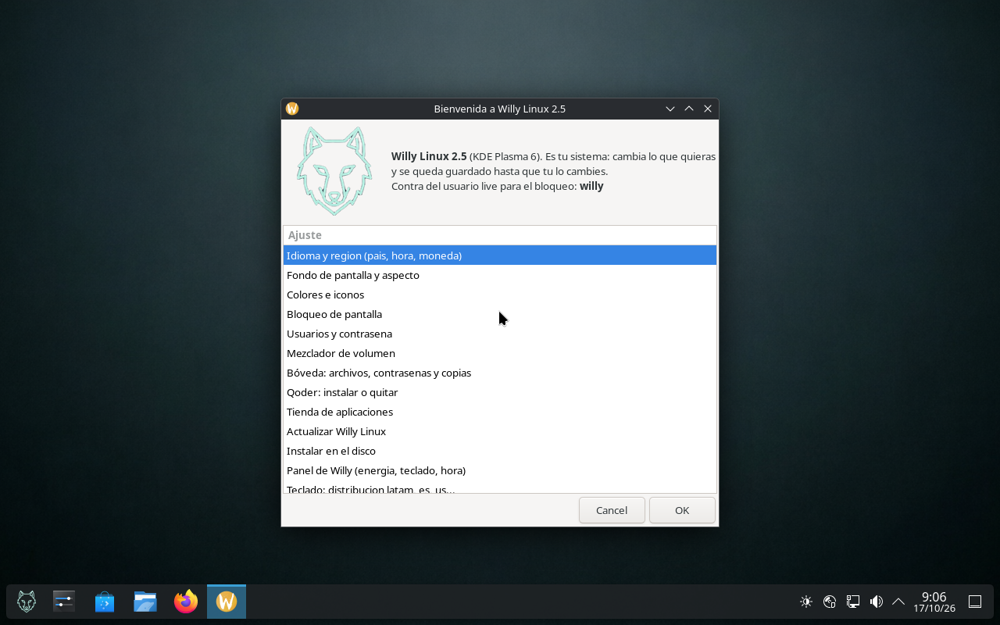
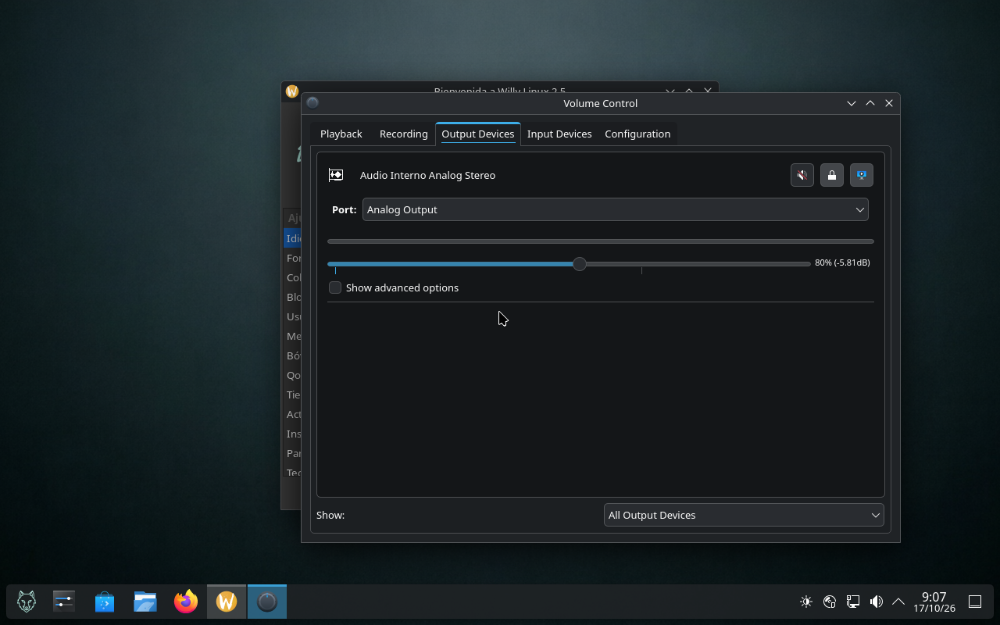

# Uso diario

## El asistente de bienvenida (`willy-bienvenida`)

Se abre solo al entrar en la sesión live de la 2.5 y es el mando de todo. Dieciséis opciones,
todas en español, con el logo y el recordatorio de la contraseña live:



| # | Opción | Qué hace |
|---|---|---|
| 1 | Idioma y región (país, hora, moneda) | idioma del sistema, zona horaria y formato regional |
| 2 | Fondo de pantalla y aspecto | escritorio y pantalla de bloqueo |
| 3 | Colores e iconos | tema `willy-dark`, claro, juego de iconos |
| 4 | Bloqueo de pantalla | tiempo de bloqueo y método de desbloqueo |
| 5 | Usuarios y contraseña | crear usuario, cambiar contraseñas |
| 6 | Mezclador de volumen | abre `pavucontrol` con dispositivos por aplicación |
| 7 | Bóveda: archivos, contraseñas y copias | Plasma Vault, KeePassXC y Back In Time |
| 8 | Qoder: instalar o quitar | el editor, solo si tú lo pides (no viene preinstalado) |
| 9 | Tienda de aplicaciones | Discover con Flathub |
| 10 | Actualizar Willy Linux | `willy-actualizar` |
| 11 | Instalar en el disco | `willy-instalar` |
| 12 | Panel de Willy (energía, teclado, hora) | abre `willy-ajustes` |
| 13 | Teclado: distribución latam, es, us… | cambia el layout al momento |
| 14 | Barra de tareas: centrar o mover los iconos | posición de la panel de Plasma |
| 15 | Mi usuario: contraseña y nombres | nombre visible, nombre de usuario y equipo |
| 16 | Guardar mis cambios (USB persistente) | `willy-persistencia` |

Si la ventana se ve recortada en una pantalla pequeña, el asistente ya lleva la altura ajustada;
en monitores de 1024×600 puede quedar justa la última fila: usa las flechas ↑ ↓ del título.

## El panel de ajustes (`willy-ajustes`)

El «Panel de Willy», con atajo en la barra. Dieciséis apartados:

| # | Apartado | # | Apartado |
|---|---|---|---|
| 1 | Teclado — distribución de las teclas | 9 | Tienda de aplicaciones (Discover) |
| 2 | Zona horaria — país y ciudad | 10 | Energía — perfil de consumo y batería |
| 3 | Reloj — NTP o poner la hora a mano | 11 | Administrador de tareas |
| 4 | Idioma — español, inglés y otros | 12 | Bóveda — carpetas cifradas |
| 5 | Contraseña — cambiar la del usuario live | 13 | Acerca de — versión y datos |
| 6 | Nombre del equipo — cómo aparece en la red | 14 | Mi usuario — contraseña y nombres |
| 7 | Apariencia y pantallas — temas, escalado, resolución | 15 | Guardar en el USB |
| 8 | Fondo de pantalla — escritorio y bloqueo | 16 | Comprobar la red |

## Cambios que se quedan guardados

Lo pedido explícitamente: si cambias el fondo, añades aplicaciones o renombras al usuario y su
contraseña, **eso permanece hasta que tú lo cambies**. Dos caminos:

- **Instalado en el disco:** todo persiste, como en cualquier sistema operativo.
- **Desde el USB:** activa *Guardar mis cambios* (opción 16). Sin eso, la sesión live es
  volátil y al apagar se pierde todo, por diseño.

`willy-guardado` imprime el modo actual (`volatil`, `persistente` o `instalado`) y
`willy-identidad` / `willy-renombre-aplicar` se ocupan de que renombrar el equipo o el usuario no
deje el sistema colgado resolviendo su propio nombre.

## Audio

- **Pipewire + WirePlumber** mandan el sonido; el icono del panel controla el volumen maestro y
  **el de cada aplicación por separado**.
- *Mezclador de volumen* (opción 6) abre `pavucontrol-qt` con pestañas de reproducción, grabación,
  salida, entrada y configuración.



- El pitido al mover el volumen o emparejar Bluetooth está incluido (`libcanberra-pulse`).
- Los perfiles `ucm2`/`tplg` de ALSA están dentro, que es lo que necesitan muchos portátiles
  (Realtek con amplificador, Intel SSE/CHT) para que la barra de volumen suba y baje de verdad.
- Comprobación rápida en un terminal: `wpctl status` y `wpctl get-volume @DEFAULT_AUDIO_SINK@`.

## Vídeos y códecs

- Códecs completos: GStreamer good/bad/ugly/libav y FFmpeg. H.264, AAC, VP8/VP9 y Opus funcionan
  sin instalar nada.
- **Decodificación por GPU (VA-API)**: `i965-va-driver` (Intel viejas), `intel-media-va-driver`
  (Broadwell en adelante), `mesa-va-drivers` (AMD/Intel), `va-driver-all` y `vainfo` para
  comprobarlo. En Firefox, si tu GPU está soportada, activa
  `media.ffmpeg.vaapi.enabled` en `about:config`; la herramienta `willy-red` te dice si hay
  controlador VA-API antes de que lo pruebes a ciegas.
- **No hay Widevine** en el `firefox-esr` de Debian: Netflix, Disney+, Prime Video y Max no
  reproducen. Para esos sitios, instala Chromium desde Discover.
- Reproductores incluidos: VLC, mpv, Audacity, MTPaint.

## Tienda de aplicaciones

Discover gestiona dos mundos a la vez: los paquetes del sistema (PackageKit) y las aplicaciones
planas de **Flathub**, con el remoto ya configurado en la imagen. Al instalar desde Flathub, el
menú se refresca solo gracias a `update-desktop-database`.

Por terminal, si te gusta más:

```sh
flatpak remotes                 # debe salir: flathub  system
flatpak search gimp
flatpak install flathub org.gimp.GIMP
```

## Sistema bóveda

Tres piezas que se usan desde el propio escritorio:

1. **Bóvedas de Plasma** (`plasma-vault` + `cryfs`): carpetas cifradas con contraseña que se
   montan y desmontan desde Dolphin. Abres la carpeta, escribes la clave, y aparece como una
   unidad normal.
2. **KeePassXC**: gestor de contraseñas con base de datos cifrada, portapapeles seguro y
   autollenado de navegadores.
3. **Back In Time** (con Borg por detrás): copias de seguridad programadas, con borrado de
   versiones y restauración desde la propia interfaz.

Nada de esto se activa solo: lo decide el usuario desde la opción 7 del asistente.

## Impresión y Bluetooth (2.1, 2.5 y 2.5.5)

- **CUPS** con su configurador web local (`http://localhost:631`) y el asistente de alta de
  impresoras del sistema.
- **BlueZ** con el gestor de Plasma: auriculares, teclados y envío de archivos. Con PipeWire, el
  audio Bluetooth aptX funciona sin configuración extra.

## Teclado latinoamericano

`keyboard-layouts=latam` viene en la línea de arranque, así que `Ñ`, `´`, `¿`, `{`, `}`, `|` y
`@` están donde deben. Para cambiar a `es`, `us` u otro en caliente, usa la opción 13 del
asistente o la opción *Teclado* del panel.

En máquina virtual, si alguna tecla sale rara, revisa primero que VirtualBox tenga seleccionado
el teclado latinoamericano (Dispositivos → Teclado → Layout); es un ajuste del huésped, no del
sistema.

## Resumen de comandos propios

```
willy-bienvenida      el asistente de 16 opciones
willy-ajustes         el panel de control
willy-instalar        instalar al disco
willy-persistencia    guardar cambios en el USB
willy-guardado        en qué modo estoy
willy-actualizar      actualizar el sistema
willy-red             ¿es la red o es el navegador?
willy-info            ficha del equipo
willy-monitor         consumo en vivo
willy-trafico         tráfico por interfaz
willy-captura         captura de pantalla
willy-identidad       nombre del equipo y del usuario
```
